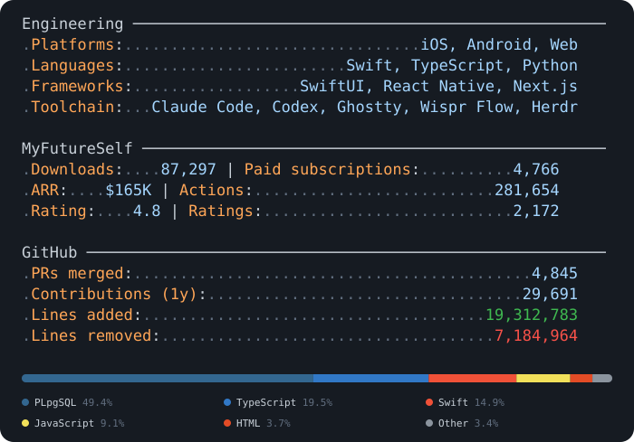

<picture>
  <source media="(prefers-color-scheme: dark)" srcset="dark_mode.svg">
  <source media="(prefers-color-scheme: light)" srcset="light_mode.svg">
  
</picture>

Updated daily from [product metrics](https://kayahickin.com/api/profile-metrics) and GitHub. Lines count authored changes on default branches, including private repos.

<picture>
  <source media="(prefers-color-scheme: dark)" srcset="https://raw.githubusercontent.com/kayahickindev/kayahickindev/output/github-snake-dark.svg">
  <source media="(prefers-color-scheme: light)" srcset="https://raw.githubusercontent.com/kayahickindev/kayahickindev/output/github-snake.svg">
  
</picture>
